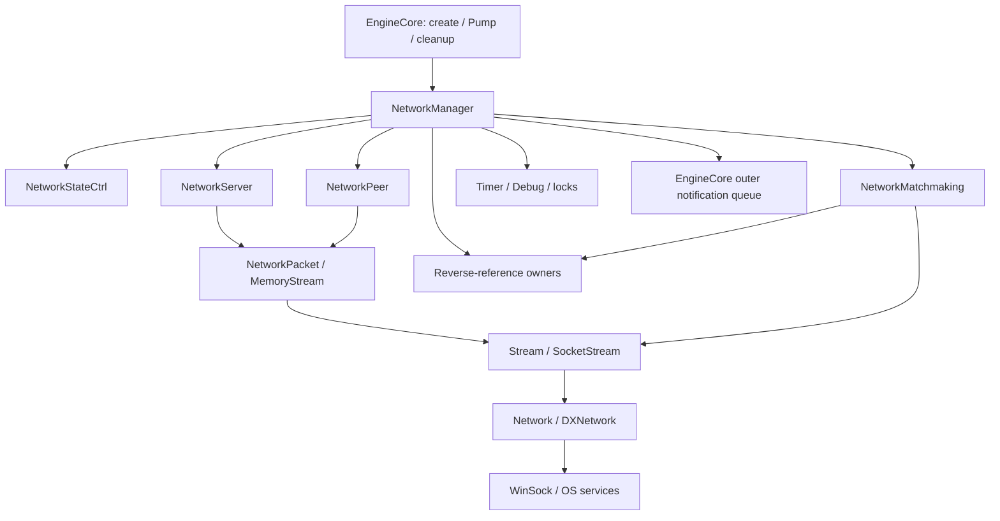
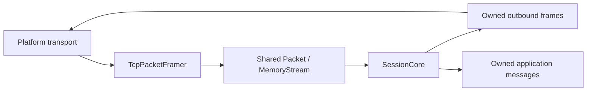

# Самостоятельная сетевая сессия и границы оригинального стека

Оригинальная сеть Sparkplug предоставляет пакетный формат, потоки, peer,
server, менеджер и controller. Известный Winx EngineCore создаёт холодный
NetworkManager и вызывает его Pump, но отдельная сетевая стадия возвращает
true без запуска служб. Producer настроек DGE, первоначального пула ID и
разрешения обработки не установлен. Эти неизвестные операции не входят
в самостоятельный путь WinxCoop, описанный ниже.

## Исходная цепочка

Это карта установленных связей, а не граф владения. Подробные layout,
порядок вызовов и необычные ветви находятся в
[карточках сетевых классов](network-family.md).

| Граница | Установленный контракт | Открытая семантика оригинала |
| --- | --- | --- |
| EngineCore → Manager | Холодное создание, Pump, удаление singleton | Кто запускает/настраивает самостоятельную сессию |
| Manager → StateCtrl | Очередь событий, известные переходы и entry-действия | Producer первоначального события `4` |
| Manager → Server/Peer | Создание служб, probe/Ready/Hello, очереди | DGE endpoints/configuration и начальная роль listener |
| Server → Packet/streams | ID, admission, handlers, dispatcher, bounded worker | Начальное заполнение ID pool/max и внешняя настройка |
| Peer → Packet/streams | Fill/Write, TCP/UDP, исходный signed send result | Ограничения размеров у всех верхних callers |
| Matchmaking → stream | Приём, `0x22`, закрытие/diagnostic | Внешний matchmaking protocol/provider |
| SocketStream/DXNetwork → ОС | Известные socket операции и ошибки | Реальные scheduling, sockets и shutdown в новой программе |

Известные packets `0..6` — InitialInfoRequest, InitialInfoReply, общие данные,
Ready, GameStart, HelloRequest и HelloReply. Их фактические обработчики
описаны в [Server](../../reference/classes/sp-network-server.md) и
[Manager](../../reference/classes/sp-network-manager.md). Исходный producer
GameStart и полный смысл unique ID не установлены. Ready означает сетевой
флаг Peer; готовность уровня и персонажа этим не задаётся.

## Получатели уведомлений

BaseObject `+04` содержит список обратных ссылок. Его элементы — **referring
owners**, удерживающие ссылку на объект. Они не являются owned children.
Manager рассылает `0x20` всем таким владельцам; для `0x1F` выбирает их по
Class ID и слову `+2C`. Matchmaking синхронно передаёт `0x22` с заимствованным
буфером. Получатель, сохраняющий данные после вызова, должен скопировать их.

`0x1F` содержит class/key, но не самостоятельный pointer на packet payload.
Конкретный Winx-получатель, использующий эти данные для персонажа, не установлен.
Ошибка Manager `0x23` идёт другим путём: через внешний механизм уведомлений
EngineCore. Полная семантика его очереди также не устанавливается обработчиками
сети. Собственная сессия ниже не зависит от этих получателей или очереди.

## Выбранный путь WinxCoop

Общая библиотека использует восстановленные **Packet Fill/Read/Write** и
**MemoryStream/Stream**. Собственные `TcpPacketFramer` и `SessionCore`
находятся в [WinxCoop](../../../tools/WinxCoop/README.md), отдельно от реконструкции.

| Часть | Причина и ответственность |
| --- | --- |
| Явная конфигурация | Role, local endpoint, guest server endpoint; без native sentinel-адресов или угаданного порта |
| Собственный bootstrap | Назначение transport ID `0/1`, ожидание клиента и разрешение старта сервером без неизвестного DGE provider |
| Persistent framing | Исходный Worker теряет fragments между проходами и prefix после позднего отказа приёма |
| Собственный coordinator | StateCtrl сохраняет stale transition state; его поведение не является безопасной session FSM |
| Собственные очереди | Ограниченные owned frames/messages вместо borrowed notification payload и необычного native queue lifetime |
| Clock/termination | Монотонные 64-битные сроки, явные EOF/error/close; без native thread Wait с проигнорированным результатом |

Эти замены не устанавливают отсутствующие функции оригинала и не изменяют
восстановленные Worker/StateCtrl. Их самостоятельный путь не использует
native Manager, Server worker, matchmaking, debug, timers, EngineCore globals
или неизвестные игровые callbacks.

## Bootstrap и обмен

Один Host SessionCore обслуживает одну Guest connection. IDs `0/1` и
неприсвоенный `BAD0` — явный контракт локального подмножества. Платформенный
слой принимает максимум одно активное гостевое соединение на сессию.

1. После установки транспорта Guest отправляет native-shaped type `0`:
   `BAD0 → 0`, payload `2A`.
2. Host отвечает type `1`: `0 → FFFF`, payload `01 00`.
3. Guest принимает только присвоенный ID `1`, отправляет type `3` с payload
   `01` и переходит в ожидание. Host после Ready также ожидает.
4. Только вызов HostStart сервером разрешает type `4`: payload
   `01 00 tokenLo tokenHi`. Token — наш идентификатор разрешённого старта,
   отдельный от transport ID; это не установленный исходный смысл unique ID.
5. После GameStart обе стороны обмениваются type `2`. Данные передаются
   приложению как самостоятельная копия вместе с class/key. Применение к
   игровому объекту, уровень и разрешение level-exit относятся к игровому adapter.

Host может разрешить старт до подключения: GameStart всё равно отправляется
только после Ready нового гостя. Это проверяет сетевое позднее подключение,
не загрузку текущего уровня игры. Guest API не может разрешить старт;
полученный от Guest GameStart отклоняется. Неверные phase/source/destination,
BAD0 assignment, неизвестный type или размер control packet завершают соединение.

Hello `5/6` сохраняют известный восьмибайтовый формат. Guest проверяет echo
одного ожидаемого запроса. Heartbeat работает и во время ожидания сервера.
Сроки считаются монотонными 64-битными значениями; 32-битные wire stamps могут
переходить через ноль. Исходные Manager zero-word/latency правила здесь не
используются. Это явное отличие собственного coordinator.

## Владение, ограничения и контракт системного слоя

Framer хранит максимум `273` bytes: header `17` плюс payload `256`. Он отдаёт
не более одного полного actual Packet за Feed, сообщает число потреблённых
bytes и не содержит внутренней очереди packet. Размер больше `256`
отклоняется до native-style Read. Ранее выданный packet переживает
последующие EOF/error/Reset framer.

SessionCore ограничивает очереди восемью outbound frames и шестнадцатью
inbound messages. Переполнение завершает соединение с явной ошибкой.
Close/failure отменяет ещё не переданные очереди. Выданные caller данные
принадлежат caller. Closed/Failed терминальны: новое соединение получает
новый SessionCore; его input не смешивается с прежней connection.

Все вызовы одного экземпляра выполняются последовательно одним owner.
Системный transport adapter обязан:

- подавать каждый положительный receive chunk в Framer до обработки
  последующего EOF/error, сохраняя уже принятый prefix;
- удерживать отправляемый frame и offset при short write, соблюдать FIFO и
  не брать следующий frame до завершения текущего;
- различать would-block, EOF и fatal error, регулярно обслуживать Tick;
- закрывать только свои sockets и закончить I/O до освобождения session;
- держать queue/session и её input привязанными к конкретному соединению.

Контрактные проверки используют два координатора, общий кодек и нарезанные
byte streams. Собственный `WindowsTcpTransport` обслуживает реальные
nonblocking Winsock sockets на одном owner thread, создаёт новый Core для
каждого соединения и сохраняет receive prefix в отдельной owned очереди.
Подробности backpressure, half-close, событий и межпроцессной проверки —
[в руководстве транспорта](../../../tools/WinxCoop/docs/transport.md).
Прикладной P проверен на физическом ПК и Windows 7 VM с фиксированной Alfea 28,
удалёнными моделями и повторным подключением; условия и границы описаны в
[руководстве игрового прототипа](../../../tools/WinxCoop/docs/prototype-runtime.md).
Две Блум, камера, ввод, уровни и серверные переходы этим сетевым слоем
не создаются: их игровые операции принадлежат адаптеру и приложению.
