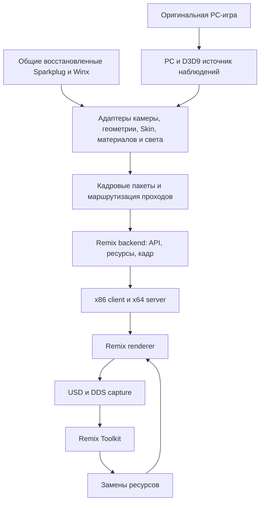

# Контракт рендеринга WinxRemix

WinxRemix заменяет графический вывод работающей PC-игры. Update, анимация,
выбор сцены и игровая логика продолжают исполняться в оригинале.
Восстановленные операции движка находятся в общих `Sparkplug/` и `Winx/`;
перевод их результата для Remix относится к нашему адаптеру.
Готовность включает игру, захват USD, открытие в Remix Toolkit и применение
замены после повторного запуска игры.

## Вход Remix

Контракт привязан к revision из [dependencies.json](../dependencies.json).
Официальные [Remix SDK](https://github.com/NVIDIAGameWorks/dxvk-remix/blob/b81a7b566b1eeb9edb4dc2b3c9d3972e0f253ad4/documentation/RemixSDK.md)
и [C API](https://github.com/NVIDIAGameWorks/dxvk-remix/blob/b81a7b566b1eeb9edb4dc2b3c9d3972e0f253ad4/public/include/remix/remix_c.h)
задают регистрацию mesh/material/light, подачу камеры и экземпляров по кадрам,
версию интерфейса и пары Create/Destroy. Описание SDK этого pin ориентировано
на x64; наш x86-путь использует отдельную совместимую пару client/server bridge.
Заголовок с `REMIX_ALLOW_X86` сам по себе не квалифицирует установленные DLL.

[Типовая совместимость NVIDIA](https://docs.omniverse.nvidia.com/kit/docs/rtx_remix/latest/docs/introduction/intro-compatibility.html)
относится прежде всего к fixed-function DX8/9. Для shader draw необходимо
восстановить смысл входов. В WinxRemix существуют исходные D3D9 draw и явная
подача через API. Для каждой переводимой ветви выбирается один путь вывода;
перехват вызова сам по себе не доказывает правильную RT-геометрию.
D3D9 служит границей совместимости оригинальной игры и Remix, не задавая API
других backend общего проекта.

## Что выдаёт игра и что требуется преобразовать

«Есть» означает доступный источник в изученной PC-ветви. Полнота всех сцен
и производных классов этим не заявлена. Отсутствие данных в нашем API-пакете
различается с отсутствием данных в игре. Результаты прогонов и происхождение
сведений хранятся в закрытых материалах исследования.

| Блок | Требуемый вход или операция | Что нативно доступно | Текущая передача и пробел |
| --- | --- | --- | --- |
| Runtime | Совместимые API, x86 bridge и x64 renderer; кадр и device lifetime | CreateDevice, Present, Reset, Release | Proxy и bridge есть. Полный набор DLL требует общей квалификации; профиль RTX не гарантирует включение native-путей |
| Камера | `SetupCamera`: view/projection, роль, правильный момент кадра | Готовые матрицы после apply, main camera, scene, render target | Native reader передаёт WORLD/main/perspective/primary. Дополнительные роли, camera cuts, offscreen и reset требуют проверки; заново вычислять матрицы не нужно |
| Жёсткая геометрия | `CreateMesh`: triangles, position3, normal3, UV2, packed color; `DrawInstance`: transform3x4 | VB/IB/declaration, world transform, Model/RenderNode и scene membership | Есть API-подача ограниченных indexed triangles. Остальные draw-kind/topology требуют наблюдения producer; для явного unlit без нормалей применяется обозначенная политика плоских нормалей |
| Видимость и экземпляры | Актуальный состав кадра, lifetime, независимая история движения | Scene render/visibility, очереди renderer, owner и destruction | Есть readers и защита от stale owners. Все типы узлов/переходы и геометрия вне основной камеры для RT-теней/отражений не подтверждены |
| Skin | Исходная сетка, все веса/индексы, палитра на кадр | Вершины, 1–4 влияния, `inverseBind × boneWorld`, 16 матриц Fixed | Есть live API-путь и знаковое представление для Remix. Полнота shader keys, нормалей, поз и импорта UsdSkel проверяется отдельно |
| Материал | Albedo, emission, alpha, UV, sampler, cull, blend и категории | Material/pass/layer, colors, texture stages, shader key/constants | Есть ограниченные stage0 FFP и Skin ColorMode4. Multi-layer/pass, ColorMode5, specular, fog и другие PS-ветви требуют восстановления используемых equations и политики преобразования |
| Текстуры | Файловые каналы API, формат/mips, актуальность и владение | Texture resources, Lock/Unlock, surface aliases, mip generation | API-путь допускает managed ARGB/XRGB 2D до 2048×2048 и 13 mips, без Usage. Default/dynamic/RT/cube и дополнительные write producers этим контрактом не покрыты; исходный D3D9 продолжает существовать |
| Прямой свет | `CreateLight`/`DrawLightInstance`, стабильный hash, pose/radiance | Загруженный реестр directional/point/spot, payload, scene membership | `SceneLightSnapshotSource` сохраняет полный реестр; `LightPayloadSource` квалифицирует равенство потребляемых слов с cache. Для наблюдавшихся обычных point lights за основной камерой подтверждены исходный world call и текущие post-call bytes. Независимый API-путь завершает поддержанный current batch до экземпляров. Все controllers, range/intensity, единицы, цвет и итоговые RT-тени требуют проверки |
| Фоновый свет и окружение | Ambient/environment, sky, fog, правильные категории | Ambient/material state, sky/fog, специальные фазы сцены | Часть raster/sky адаптаций есть. Environment и fog нельзя вывести только из direct lights; полный RT-контракт открыт |
| Частицы | Геометрия/эмиттер, billboard, age, blend/depth, lifetime | Готовые CPU quads и отдельная shader-баллистика | Формулы частично восстановлены, целого RT-адаптера нет. CPU quads передаются без повторной деформации; shader branch и решение менеджера об update рассматриваются отдельно |
| Специальные проходы | Отражения, camera-view, targets, projection, alpha и порядок | Target/camera-view материалы, scene phases, depth/blend/target state | Роль каждого используемого прохода не установлена. Нужен выбор RT-представления или доказанного raster-пути. Назначение «вода» по одному target недопустимо |
| UI и экранные эффекты | Raster UI/overlay в правильном порядке | Orthographic и экранные draw, text/quad producers | Есть UI/menu адаптации. Весь UI, lens flare, movie и экранные эффекты требуют покрытия; отправка всех draw как world triangles неверна |
| Идентичность для Toolkit | Постоянный ID для capture/replacement и отдельно lifetime экземпляра | Содержимое ресурсов, структура mesh/material; адреса объектов меняются | Ordinary independent/selected API key задаётся content IDs; legacy Skin сохраняет прежние ключи. Отдельный opt-in renderer patch связывает ID одной rigid Opaque поверхности с capture/mod lookup. Production runtime и повторный запуск с заменой ещё требуют квалификации |
| Захват и replacement | GPU → capturer → USD/DDS → reopen → Toolkit → replacement в игре | Переданные ресурсы/экземпляры/камера; Skin-палитра без исходной иерархии суставов | Есть патчи экспортёра и ограниченные CPU/GPU стенды. Полный игровой цикл на одном runtime, все каналы и повторный запуск с заменой не квалифицированы |

Исходные контракты: [матрицы](../../../docs/engine/rendering/renderer-matrix-inputs.md),
[SceneRender](../../../docs/engine/rendering/scene-render-runtime.md),
[очереди/callbacks](../../../docs/engine/rendering/renderer-protocol.md),
[Skin](../../../docs/engine/animation/skin-deformation.md),
[освещение материала](../../../docs/engine/materials/material-lighting.md),
[CPU particles](../../../docs/engine/effects/ballistic-cpu-draw.md)
и [shader particles](../../../docs/engine/effects/ballistic-shader.md).
Границы адаптеров: [development](development.md), [Skin packets](skin-packets.md)
и [USD capture](usd-capture.md).

## Идентичность ресурса и экземпляра

Нужно различать четыре значения:

- Собственный content ID геометрии/материала и API ID их неизменяемой связки:
  определяются переданным содержимым, без локальных адресов.
- Renderer ID для capture/replacement: требует отдельного контракта и
  воспроизводимости при повторном запуске; не равен API handle автоматически.
- Запись живого cache: связывает ключ с текущим backend handle и его
  пригодностью; пересоздаётся после retirement или Reset.
- Идентификатор живого экземпляра: отделяет одинаковые сетки разных актёров
  и повторное использование адреса; сохраняет независимую историю движения.

[ResourceIdentitySource](../winx_resource_identity.h) задаёт отдельные собственные
идентификаторы материала, содержимого геометрии и её неизменяемой привязки к
материалу. Independent/selected и legacy expanded Surface rigid API key получается из meaningful vertex
fields, порядка индексов и стабильного material ID живого владельца в registry.
Адреса, API handles, SDK padding, world/frame и поколения в эти bytes не входят.
Проверка владельца и актуальности перед draw сохраняется отдельно.

[Skin resource](../winx_skin_gpu_submit.h) пока смешивает owner identity и
material handle в ключе, который [CreateSurfaceGeometryOwned](../winx_surface_submit.h)
передаёт как `MeshInfo.hash`. Indexed CPU Skin также сохраняет старую схему;
legacy expanded Surface использует общий rigid content adapter.
Поведение replacement на повторном запуске требует проверки
renderer/Toolkit; стабильный собственный API hash без проверки renderer и
motion history не закрывает задачу.

В x86 [client bridge закреплённой версии](https://github.com/NVIDIAGameWorks/dxvk-remix/blob/b81a7b566b1eeb9edb4dc2b3c9d3972e0f253ad4/bridge/src/util/util_remixapi.h)
handle представляет последовательный UID, зависящий от порядка создания.
В x64 renderer material handle формируется из material hash. Эти два
представления нельзя считать одной постоянной identity ресурса.

Дополнительно [CreateMesh закреплённого renderer](https://github.com/NVIDIAGameWorks/dxvk-remix/blob/b81a7b566b1eeb9edb4dc2b3c9d3972e0f253ad4/src/dxvk/rtx_render/rtx_remix_api.cpp)
использует `MeshInfo.hash` как handle, но задаёт geometry component hashes
отдельным процессным счётчиком. Capturer получает ID из geometry hashes, а
[submitExternalDraw](https://github.com/NVIDIAGameWorks/dxvk-remix/blob/b81a7b566b1eeb9edb4dc2b3c9d3972e0f253ad4/src/dxvk/rtx_render/rtx_scene_manager.cpp)
обходит обычный поиск mesh/material replacements. Таким образом, изменение
одного нашего API hash не обеспечивает постоянный USD ID и замену в игре.
Существующие USD/stride/emission patches эту цепочку не меняют.

Собственный [external asset identity patch](../renderer-resource-identity/README.md)
добавляет отдельные поля capture/replacement и сохраняет прежние geometry
component hashes. Настройка выключена по умолчанию; caller должен заранее
гарантировать постоянные ненулевые ID и неизменяемую привязку материала.
В первой версии допущены одна rigid Opaque поверхность, Opaque material mod,
одна mesh/includeOriginal запись либо пустая замена. Неподдержанные источники
и формы mod явно возвращаются к исходной подаче. Имена capture и lookup
используют ту же пару ID; BLAS material lookup сохраняет внутренний content hash.
CPU recording fixtures проверяют эти функции отдельно от production renderer.
На production renderer квалифицирован контролируемый однокадровый capture
без текстур: USD сохраняет ID, исходные данные geometry/material и размещение
экземпляров после перезапуска с другим порядком создания ресурсов. История
движения и передача текстур этим контрактом ещё не квалифицированы.
Полный capture → Toolkit → mod → повторный запуск на одном runtime открыт.
Отдельно проверены создание и открытие проекта этого контролируемого захвата
в Toolkit, выбор replacement-слоя, импорт текстуры через настоящий MCP,
изменение существующего входа материала и сохранение mod. Независимый процесс
USD SDK прочитал записанную замену с диска. Она относится к двум API-экземплярам
общего материала; контрольный native draw не имеет этой capture-привязки.
Закрытие и повторное открытие изменённого проекта через Toolkit и применение
mod в runtime остаются отдельными непроверенными этапами.
Явные mesh/material capture ID сохраняются в каждом экземпляре: общий BLAS
может содержать admission первого draw кадра. Для недопущенного экземпляра
сохраняется прежний BLAS hash, без заимствования asset ID соседнего draw.

Renderer также использует mesh handle для пространственного поиска предыдущего
экземпляра. Разные актёры с одной сеткой должны сохранить раздельные occurrence
handles; постоянный ID capture/replacement требует отдельного поля или явно
проверенного override. Geometry hashes участвуют и в cache/BVH: заменять их
единым asset ID без проверки деформации и motion history нельзя.

## Данные сцены вне основной камеры

Набор исходных raster draw не является полным входом RT. Свет за камерой может
освещать видимую поверхность; невидимая в основной камере геометрия может
участвовать в тени, отражении и непрямом освещении. Собственная RT-политика
должна различать исходную camera selection, загруженную принадлежность сцене,
логическую активность и актуальность producer данных.

[SceneLightSnapshotSource](../winx_scene_light_snapshot.h) через
[scene reader](../winx_scene_audit.h) обходит полный загруженный LightManager
registry до 512 записей. Снимок владеет байтами и сохраняет inactive/disabled и
dirty записи; reader проверяет ссылки и принадлежность сцене без camera selection.
[Lights adapter](../winx_scene_lights.h) отдельно выбирает поддержанный активный
прямой свет, без camera-frustum фильтра. Восемь исходных D3D slots каждого
объекта не являются инвентарём света сцены.

[LightPayloadSource](../winx_light_payload_source.h) через
[native light reader](../winx_native_light_source.h) вычисляет наблюдаемые поля
общим [PC4B53C0](../../../Sparkplug/Code/SparkplugDX/spPCLightPayload.h).
Owned result различает `Invalid`, `Dirty`, `CachedMismatch` и `CachedEquivalent`,
сохраняет cached/candidate слова, consumed/difference masks и отдельно
`worldDirtyMask`/`lightDataDirty`. Candidate остаётся диагностикой из cached
world inputs. Только `CachedEquivalent` разрешает source switch с сохранением
непотребляемых native слов; exact-match флаги и schema журнала сохраняются.
Dirty payload не обновляется, отказ оставляет cached native значения.

[LightWorldObserver](../winx_light_world_observer.h) и
[PC entry adapter](../winx_native_light_world_source.h) сохраняют owned before/after
bytes реальных исходных вызовов `4B58D0`, включая secondary `4B5960` после
коррекции receiver. Оригинальный producer вызывается один раз, полный аргумент
и opaque EAX сохраняются; dirty repair и повторного update нет. Публикация
связывается с нормальным завершением известного plain Root и Manager.
Две заранее выделенные банки по 512 samples и лимит 4096 вызовов ограничивают
наблюдение. Собственные epoch/activity invalidations не меняют core root
serial, tokens, counters и schema 1.

Lookup различает `Current`, `Changed`, `NotObserved`, `Unqualified`.
`Current` означает совпадение наблюдённых post-call bytes при текущих guards;
`NotObserved` не доказывает отсутствие или пропуск producer. Ни один статус
не устанавливает lifetime объекта или fresh RT world/controller inputs.
В конце кадра свежий loaded registry сопоставляется только со сценами,
имеющими известные текущие Root tokens; журнал содержит per-light status,
type/enabled, world position bits, `cachedRangeBits` и counts.
Range-слово берётся из исходного DX cache без пересчёта.
Установка требует startup identity,
core hook/slot/prefix и quiescence; launcher отдельно проверяет полный Debug EXE
SHA256. Неатомарный восьмибайтовый entry patch не является live-install API.

Для наблюдавшихся обычных point lights за исходной основной камерой
подтверждено исполнение оригинального `4B58D0`. В том же кадре при завершённых
известных Root/Manager их записи в полном registry совпадают с owned post-call bytes.
По этой ветви данных игра уже предоставляет world producer: восстанавливать
его дубликат для обхода предполагаемого camera gate не требуется.
Это не доказывает видимый receiver, влияние источника, тени, покрытие всех
сцен или свежесть всех controller inputs.

[Анализатор](../analyze_light_world_observer.py) коррелирует только одинаковые
frame/scene с единственным packet исходной камеры и стабильной диагностикой
кадра. Исходные row-vector view/projection применяются к cached world position.
В зачёт наблюдавшегося включённого источника за камерой входят только
`Current`, enabled point `1`/spot `2`; cached position других observer statuses
остаётся отдельной диагностикой. Directional `0` и ambient `3` исключены.
Missing/multiple camera,
неактуальный context и нечисловые входы дают `Unqualified`.
В системном D3D9 camera packet с `native=false`/`accepted=false` остаётся
наблюдением оригинальных матриц без API submit. Классификация с численным
допуском не доказывает native x87 или GPU equivalence. Типы и операции
описаны в [spLightData](../../../docs/reference/classes/sp-light-data.md),
[spDXLight](../../../docs/reference/classes/sp-dx-light.md),
[spCamera](../../../docs/reference/classes/sp-camera.md) и
[Node world](../../../docs/engine/scene/node-world.md).

Анализ cached range отделён от origin: только camera-joined enabled `Current`
point с конечным положительным range получает границу сферы относительно
плоскости камеры. Норма столбца глубины view учитывает affine scale;
максимальная глубина за отрицательным численным допуском даёт
`WhollyBehindCameraPlane`. Пересечение и касание классифицируются отдельно,
как и события, пары frame/scene и scene/address keys этой диагностики.
Старый журнал без `cachedRangeBits` сохраняет origin-учёт и получает
`MissingCachedRange` на range-этапе. Объём spot не квалифицирован.
Это граница диагностической cached сферы, без установления RT-формы,
влияния на receiver, потребности в тенях или fresh RT inputs.

В [базовом PC-цикле](../../../docs/engine/architecture/engine-frame.md) Animation
и Scene/world предшествуют graphics. Обычный Node world не имеет
camera/frustum gate; per-object range/active selection света выполняется
отдельно. [Локальный dirty `1`](../../../docs/engine/effects/light-world.md)
обновляет DX payload, но сам по себе не вызывает per-object cache refresh;
[явный dirty `8`](../../../docs/engine/effects/light-scene-world.md) вызывает
этот refresh. Raw property без marker оставляет старый payload. Это базовая
цепочка Node → Light → DX; соответствие live custom overrides и всех controller
зависимостей не квалифицировано.

Снимок не гарантирует атомарность или свежесть producer потомков, а равенство
потребляемых слов не является доказательством свежего RT-вычисления. Полнота
реестра не доказывает, что оригинал обновил все необходимые RT light producers.
Ambient/environment и некоторые direct/projected-shadow ветви остаются
непокрытыми.

[SceneGeometrySnapshotSource](../winx_scene_geometry_snapshot.h) выделяет
membership reader из [scene geometry adapter](../winx_scene_geometry.h).
Stateless std-only класс получает reader/mutation callbacks на один `Capture`
и обходит загруженные partition children/zone roots без camera/active selection.
Снимок владеет отсортированными уникальными `supports` и отдельными occurrences
с source/ordinal. Повторы сохраняются во вхождениях; null-слоты пропускаются
без сдвига ordinal. Динамическая membership включает Skin и не применяет
rigid eligibility. Числовые node/object/support адреса служат текущему join,
без persistent IDs, native borrow или гарантии lifetime.

Сохраняются лимиты: nodes/supports/vector — по 4096, children — 8,
pending — 32768, occurrences — 65536. `valid` квалифицирует membership,
`occurrencesComplete` отдельно показывает полноту provenance. Переполнение
или отказ дополнительного occurrence allocation не отзывает membership;
обязательные allocations могут завершиться исключением. Mutation metadata
сравнивается до/после чтения, без доказательства атомарности, поколения native
объектов или FreshRt. Снимок не содержит mesh bytes, world/resource freshness
или material eligibility.

Изменение original selection остаётся в PC-адаптере; он добавляет поддержанные
отсутствующие supports. [Independent source](../winx_independent_scene_source.h) получает этот
реестр, а [submit](../winx_independent_scene_submit.h) может отправлять complete
ordinary groups, которые исходная камера не выбрала. Ограничения сохраняются:
только загруженная supported partition graph, известные ABI и ограниченные
plain Model/unlit material inputs. Custom dynamic supports и обычная Scene
без partition root не покрыты этим обходом. Skin зависит от оригинального
mesh producer; обновление plain world root не доказывает свежесть всех потомков.

[Пассивный geometry observer](../winx_geometry_snapshot_observer.h) через
`-GeometrySnapshotObserver` наблюдает original selection до extension.
Callback независим от прежнего ObserveOnly; на sampled кадрах с периодом 300
он выполняет новый `ReadRegistry` вместо scope first-snapshot cache.
Original/system допустим без SceneGeometry extension и API submit.
Один JSONL scope содержит `rows[]`; зачёт требует `completed`, `fencesStable`
и `updateValid` одновременно. Лимиты 4096 rows, 4 МиБ/scope и 16 МиБ/log
проверяются до записи; частичный scope не квалифицируется.

Общий `ReadWorldInput` даёт отдельную world qualification без счётчиков
independent submit. Mesh qualification требует `ResolveCurrentResources`,
обоих полных uploaded buffers, совпадения обоих native CPU-covered ranges
и current transport. Partial CPU capture не превращается в whole-buffer
equality; verified mark не устанавливается. Native producers, COM и API
не вызываются; собственный layout cache может материализоваться.
Selected slots, supports, registrations и model rows разделены, numeric IDs
ограничены scope, custom dynamic supports не покрыты. Совпадение phase/world/mesh
не означает всеобщую FreshRt, lifetime, material/draw eligibility или visual
qualification. Camera/cached sphere diagnostics не доказывают положение
всей реальной mesh. Запуск и CPU-проверка описаны в
[руководстве](guide.md) и [устройстве адаптера](development.md).

[FrameScheduler](../winx_frame_scheduler.h) задаёт в независимом API-пути порядок
camera → полный поддержанный текущий direct light batch → instances. При
включённых флагах этот путь работает до первого исходного draw. Неполный
пакет света не разрешает геометрию. После COM-чтения target и `Release`
полученной ссылки состояние операции проверяется до синхронизации света;
revision, epochs, scope и light witness проверяются перед экземплярами и
после внешних API-вызовов. Уже вызванный частичный submit сохраняется в учёте
draw и не разрешает повторить те же экземпляры через fallback.

Следующий незакрытый сценарий — active point/spot за камерой с видимым receiver:
полный реестр → исходный cache/slots → world/dirty/payload → API.
Наблюдение world call и позиции источника само по себе эту цепочку не закрывает.
Только установленный отсутствующий или пропущенный
producer/update воспроизводится отдельно для RT. Оригинальная visibility
сохраняется как эталон; собственная RT eligibility не записывается в её код
как будто это исправление реконструкции.

## Границы модулей и классов

Схема описывает направление зависимостей. Реализованы
[RemixApiSession](../winx_remix_api_session.h),
[RemixResourceRegistry](../winx_remix_resource_registry.h),
[SceneLightSnapshotSource](../winx_scene_light_snapshot.h),
[SceneGeometrySnapshotSource](../winx_scene_geometry_snapshot.h),
[LightPayloadSource](../winx_light_payload_source.h),
[LightWorldObserver](../winx_light_world_observer.h) и
[FrameScheduler](../winx_frame_scheduler.h). Остальные имена задают границы
предстоящего переноса. Native/COM адаптеры и direct light ownership ещё сохраняют
состояние proxy; полные `SceneSnapshot` и instance registry не выделены.

[RigidGeometryPacketBuilder](../winx_rigid_geometry_packet.h) выделяет собственный
результат конверсии для independent и selected submit: expanded triangles,
material coefficients и scoped provenance. Пакет не хранит native/COM pointers,
API handles или `pNext`. В него также входят собственная поддержанная material recipe,
equations, instance/bootstrap и числовое описание текстуры с lifecycle/content
generations. Это описание не владеет pixels и не даёт права отправки: адаптер
заново получает transport witness и проверяет его перед внешними вызовами.

Material recipe, bootstrap устройства, собственная unlit policy и asset binding
разделены внутри этой границы. Sampler, equations и instance после внешних вызовов
берутся из пакета. При повторном входе, меняющем текстуру во время чтения mip,
проверка актуальности предшествует публикации content hash и DDS. Отвергнутый
захват не должен вновь заполнить кэш устаревшим хешем.

[TextureMipSnapshotSource](../winx_texture_mip_snapshot.h) отдельно владеет raw
mip-пикселями и описанием managed2D ARGB/XRGB-текстуры. D3D-адаптер удерживает
временную COM-ссылку до закрытия всех readonly Lock, освобождает её и только
затем проверяет актуальность. Hash и DDS строятся из одного снимка; XRGB alpha
остаётся raw для hash и нормализуется лишь для DDS. Снимок запрашивается при
отсутствующем hash либо необходимых pixels для нового DDS. Уже известные ресурсы
сохраняют быстрый путь с проверкой поколений. Это ещё не persistent Toolkit ID
и не квалификация времени жизни Model/Skin.

[MaterialRecipeSource](../winx_material_recipe_source.h) читает ограниченную
native material/pass/layer/texture цепочку в собственные значения и использует
общие восстановленные PC mappings. Проекция equations в Remix и bootstrap
остаются снаружи. Independent/selected submit отвергает textured packet при
ненулевом debug byte1F либо недоступном singleton и повторно проверяет это
условие при потреблении. Сам оригинал при NULL singleton вызывает ленивый
конструктор; наш reader его не воспроизводит. Подробнее —
[исходная привязка текстуры](../../../docs/engine/materials/material-pass-binding.md).
Успешное чтение recipe не подтверждает все виды материалов, актуальность
controller или право отправки.



| Модуль / класс | Ответственность | Компоненты и состояние |
| --- | --- | --- |
| `PcGameSource`, `D3D9StateSource` | EXE/ABI/hooks, актуальные наблюдения; без material policy и API Create | Native readers, scene geometry, state witness |
| `SceneSnapshot`, `InstanceRegistry` | Загруженная RT scene membership отдельно от camera selection; producer freshness, generation, token/retirement | Scene/native owner readers, independent source; полные классы ещё не выделены |
| `SceneLightSnapshotSource` | Полный загруженный Light registry, проверка membership и собственные копии raw bytes | Выделен из scene audit; std-only, readers заданы снаружи, без producer refresh и camera selection |
| `SceneGeometrySnapshotSource` | Загруженная support membership и отдельная provenance в собственных векторах; valid отдельно от occurrencesComplete | Выделен из scene geometry adapter; stateless std-only с injected reader/mutation, без camera/active/rigid eligibility и без freshness/lifetime claims |
| `LightPayloadSource` | Owned cached/candidate payload, dirty причины, consumed-word equality и source qualification | std/shared PC4B53C0; подключён к native light Resolve, candidate не доказывает world/controller freshness |
| `LightWorldObserver` | Bounded owned before/after native call observations и context/ticket guards | std-only; отдельный PC entry adapter связывает known Root/Manager, без producer replay/repair и lifetime/fresh RT claims |
| `CameraAdapter` | Роль/target/матрицы и момент подачи камеры | Native camera, Present/Reset в proxy; отдельный класс ещё не выделен |
| `FrameScheduler` | Порядок camera → supported current direct lights → instances, актуальный scoped ticket, reentry | std-only класс; подключён к independent API submit, native/COM/API работа в адаптерах |
| `GeometryAdapter`, `SkinAdapter` | Declaration/topology/transform; деформация и веса с общим восстановленным эталоном | Общий Surface converter и owned `RigidGeometryPacketBuilder` для rigid independent/selected; Skin packet/GPU submit |
| `MaterialAdapter`, `TextureSource` | Equations → albedo/emission/alpha; UV/sampler, актуальные mip assets | Выделены `MaterialRecipeSource` и `TextureMipSnapshotSource`; independent/selected hash и DDS используют owned pixels, Surface/Skin projection, binding и transport остаются в адаптерах |
| `LightingAdapter` | Current registry → явная световая политика | Scene lights и native light source |
| `ParticleAdapter`, `ScenePassRouter` | CPU/shader particles, world/sky/UI/overlay/offscreen, способ вывода | Particle contracts, UI/sky/roles в proxy; полный adapter отсутствует |
| `RemixApiSession` | Одна попытка init версии, API table, исходный result | Выделен из GetRemixApi; DLL resolution и logging снаружи |
| `RemixResourceRegistry` | Handles/Create/Destroy, cache/pressure/quarantine/retirement, epochs и операция владения | Выделен из Surface; API resolver, frame и mutex заданы снаружи; текущие keys сохранены |
| `RemixFrameRenderer` | Подача актуальных пакетов, submit result и один commit draw; отдельный renderer identity contract | Выделен `ResourceIdentitySource` для own content/API IDs; submit helpers, перенос и renderer capture/replacement identity ещё открыты |
| `CaptureValidation` | Полная цепочка capture/reopen/replacement на том же runtime | Renderer USD patches, fixtures/анализаторы; exporter принадлежит renderer |

Пакет содержит собственные копии массивов вершин, индексов, матриц и material
recipe либо явный ограниченный borrow с проверяемым token. Native/COM pointers
не становятся сериализуемыми IDs. SDK structs/`pNext`/handles формирует backend;
общий восстановленный код не включает Remix. Диагностический sampling не
служит источником production кадра.

## Правила переноса и проверки

Каждый блок проходит цепочку: оригинальный producer → общая восстановленная
операция при необходимости → наш пакет → преобразователь → API resource/submit
→ законченная проверка. Готовые данные не требуют восстановления дублирующего
producer. Неизвестная игровая ветвь остаётся неизвестной до наблюдения.

Сначала отделяется существующее поведение, затем расширяется покрытие. Один
класс имеет один владелец состояния. Перенос header-ов с прежними globals
в каталоги сам по себе границы не создаёт. Новые `.cpp`/библиотеки/targets
подключаются вместе со всеми snapshot/build scripts и проверками владельца.

Submit различает «API не вызывался», «вызван», «вернул успех» и «состояние
осталось актуальным». После вызова ошибка/reentry не доказывает отсутствие
отправки; повторный исходный draw может создать дубль. Ownership, reentry,
retirement и ограничения cache сохраняются и проверяются при переносе.

CPU/recording API, GPU, оригинальная игра и Toolkit получают отдельный зачёт.
Для релизного контракта нужны один runtime, реальные сцены, переход/Reset и
отсутствие stale/duplicate resources. Для Toolkit также нужны конец экспорта,
reopen со всеми DDS/mips/bindings, согласованная Skin-анимация и повторный
запуск игры с тем же replacement ID.

## Проверка первого backend-класса

```powershell
powershell -NoProfile -ExecutionPolicy Bypass -File tools/WinxRemix/Test-RemixApiSession.ps1 -Name fresh-session-x86 -Platform x86
```

Стенд использует pinned C API и собственные callbacks. Он проверяет version,
struct type, single attempt, reentry, отсутствие entry point, partial table
при failure и точный result. Игра/устройство/GPU не запускаются. Для полного
proxy дополнительно нужна сборка [Build-Probe](../Build-Probe.ps1); recording
стенды проверяют потребителей, но не квалифицируют установленный renderer.

## Проверка владельца ресурсов

```powershell
powershell -NoProfile -ExecutionPolicy Bypass -File tools/WinxRemix/Test-RemixResourceRegistry.ps1 -Name fresh-registry-x86 -Platform x86
powershell -NoProfile -ExecutionPolicy Bypass -File tools/WinxRemix/Test-ResourceOwnership.ps1 -Name fresh-registry-ownership
powershell -NoProfile -ExecutionPolicy Bypass -File tools/WinxRemix/Test-SkinPacketSubmit.ps1 -Name fresh-registry-skin -Platform x86
```

Самостоятельный стенд компилирует класс без proxy/Windows/D3D и проверяет две
независимые API-таблицы, кадры и наборы ресурсов, отбрасывание чужой операции,
cache/liveness и balanced retirement. Existing fault/pressure стенды проверяют
отказы выделения памяти и API Create/Destroy, nonnull handle при failure,
reentry/deferred retirement, лимиты и unsigned frame wrap. Skin проверяет
действующего потребителя. Для injection записей прежних fixtures существует
test-only friend; production storage закрыто и доступно через операции и const
представления. Класс не вычисляет asset IDs и не определяет RT visibility.

Самостоятельные проверки источника света и кадрового порядка:

```powershell
powershell -NoProfile -ExecutionPolicy Bypass -File tools/WinxRemix/Test-FramePreparation.ps1 -Name fresh-light-snapshot-x86 -Platform x86 -Suite LightSnapshot
powershell -NoProfile -ExecutionPolicy Bypass -File tools/WinxRemix/Test-FramePreparation.ps1 -Name fresh-frame-scheduler-x86 -Platform x86 -Suite Scheduler
powershell -NoProfile -ExecutionPolicy Bypass -File tools/WinxRemix/Test-FramePreparation.ps1 -Name fresh-light-payload-x86 -Platform x86 -Suite LightPayload
powershell -NoProfile -ExecutionPolicy Bypass -File tools/WinxRemix/Test-FramePreparation.ps1 -Name fresh-light-payload-x64 -Platform x64 -Suite LightPayload
powershell -NoProfile -ExecutionPolicy Bypass -File tools/WinxRemix/Test-FramePreparation.ps1 -Name fresh-light-world-observer-x86 -Platform x86 -Suite LightWorldObserver
powershell -NoProfile -ExecutionPolicy Bypass -File tools/WinxRemix/Test-FramePreparation.ps1 -Name fresh-light-world-observer-x64 -Platform x64 -Suite LightWorldObserver
powershell -NoProfile -ExecutionPolicy Bypass -File tools/WinxRemix/Test-NativeLightWorld.ps1 -Name fresh-native-light-world
```

Самостоятельные suites `Test-FramePreparation` используют стандартный C++ без
Windows/D3D/Remix API: owned raw snapshot и структурные отказы, новые чтения,
callback order, context invalidation, reentry и исключения.
`LightPayload` также проверяет общий producer на известных directional/point/spot
inputs, masks, dirty причины и сохранение непотребляемых слов. Интеграция
source switch проверяется `Test-NativeLightSource.ps1`; его exact-match зачёт
не означает свежесть всех world/controller зависимостей.
`LightWorldObserver` проверяет без выделений в методах limits, owned samples,
context/reentry/exception fences и отмену tickets. PC-стенд `Test-NativeLightWorld`
исполняет собственные x86 тела и наш entry adapter, проверяя вызов оригинала,
ABI, Root/Manager correlation, SEH, foreign activity и loaded scene census.
Он не запускает оригинальную игру/GPU и не доказывает live custom producer
coverage или свежесть RT-данных.
Интеграцию проверяют `Test-IndependentSubmit.ps1`, `Test-SelectedSubmit.ps1`,
`Test-SceneLights.ps1` и `Test-LightOwnership.ps1` с собственными буферами и
записывающим API. Первый API-кадр, incomplete direct batch, COM/API reentry
и частичный commit проверяются отдельно от реальной игры и GPU. Эти стенды
не закрывают descendant producer freshness, ambient/environment или
renderer capture/replacement.
